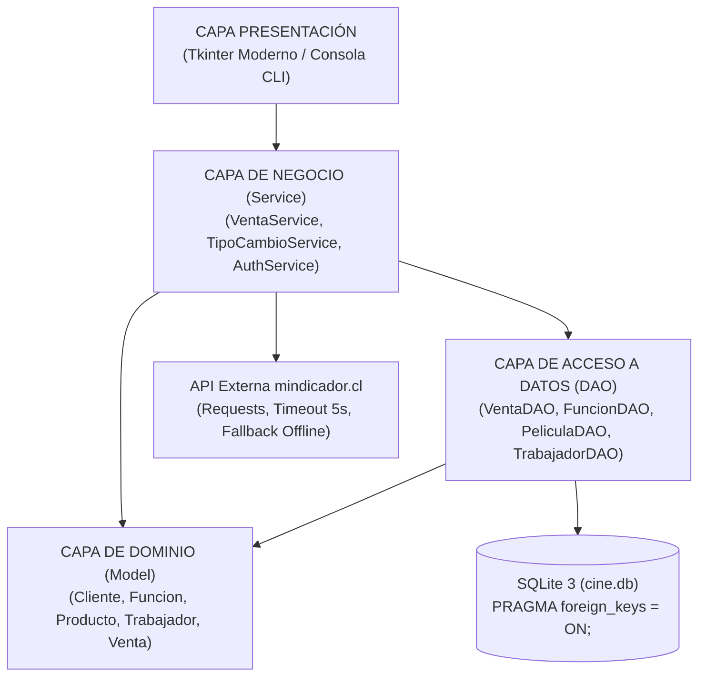

# 🛠️ MANUAL TÉCNICO DE ARQUITECTURA Y CÓDIGO
## CINE ESTRELLA — SISTEMA INTEGRAL DE GESTIÓN (VERSIÓN 4.0)

**Asignatura:** Programación Orientada a Objetos Segura  
**Institución:** INACAP — Sede Puente Alto (2026)  
**Docente:** Michael Alexis Arjel Mayerovich  
**Integrantes:** Fernando Durán / Johan Vargas  
**Caso de Negocio:** 11 – CINE ESTRELLA  
**Versión:** 4.0 (Clean Architecture, POO Segura, Tkinter GUI + CLI de Respaldo)  

---

## 1. Arquitectura General del Sistema

El sistema implementa una arquitectura modular desacoplada en cuatro capas independientes: **Dominio (Model)**, **Acceso a Datos (DAO)**, **Lógica de Negocio (Service)** y **Presentación (UI / CLI)**.



### Árbol de Directorios Limpio (Versión 4.0)

```text
version4/
├── main.py                     # Punto de entrada unificado (lanza GUI por defecto o CLI con --consola)
├── iniciar_cine.bat            # Lanzador para Windows (doble clic)
├── requirements.txt            # Dependencias externas (requests, fpdf2, pillow)
├── .gitignore                  # Reglas de exclusión para Git (__pycache__, temporales, etc.)
├── cine.db                     # Base de datos relacional SQLite
│
├── model/                      # CAPA DE DOMINIO POO (Una clase por archivo, encapsulamiento estricto)
│   ├── cliente.py              # Entidad Cliente con validación Módulo 11 (@property)
│   ├── pelicula.py             # Entidad Pelicula con clasificación de edad y es_apta()
│   ├── funcion.py              # Clase abstracta base Funcion
│   ├── funcion_2d.py           # Subtipo 2D (cálculo polimórfico de precio base)
│   ├── funcion_3d.py           # Subtipo 3D (cálculo polimórfico con recargo tecnológico)
│   ├── funcion_vip.py          # Subtipo VIP (cálculo polimórfico y cupos acotados a máx 30)
│   ├── producto.py             # Clase base Producto
│   ├── producto_nacional.py    # Subtipo Nacional con precio fijo en CLP
│   ├── producto_importado.py   # Subtipo Importado con cotización dinámica en USD
│   ├── trabajador.py           # Clase base Trabajador con hashing SHA-256 + salt
│   ├── boletero.py             # Subtipo Boletero (permisos exclusivos de entradas)
│   ├── encargado_dulceria.py   # Subtipo EncargadoDulceria (permisos exclusivos de confitería)
│   ├── entrada.py              # Boleto emitido vinculado a función y butaca
│   ├── venta.py                # Composición Venta ♦── 1..* DetalleVenta
│   ├── detalle_venta.py        # Línea de detalle con trabajador emisor asignado
│   ├── tipo_cambio.py          # Entidad de cotización del dólar
│   ├── excepciones.py          # Excepciones de negocio (SinAsientos, RestriccionEdad, ReglaNegocio)
│   └── __init__.py
│
├── dao/                        # CAPA DE ACCESO A DATOS (Consultas 100% parametrizadas)
│   ├── conexion.py             # Contexto SQLite con PRAGMA foreign_keys = ON y row_factory
│   ├── db_init.py              # DDL de creación de tablas y siembra inicial segura
│   ├── cliente_dao.py          # CRUD y búsqueda parametrizada de clientes por RUT
│   ├── pelicula_dao.py         # CRUD de Películas con protección referencial
│   ├── funcion_dao.py          # CRUD de Funciones con reconstrucción polimórfica
│   ├── producto_dao.py         # CRUD de Productos (Nacionales e Importados)
│   ├── trabajador_dao.py       # CRUD y autenticación criptográfica de trabajadores
│   ├── venta_dao.py            # Transacción atómica de ventas unificadas y cuadraturas
│   └── __init__.py
│
├── service/                    # CAPA DE LÓGICA DE NEGOCIO Y SERVICIOS EXTERNOS
│   ├── tipo_cambio_service.py  # Integración REST con mindicador.cl con timeout y tolerancia a fallos
│   ├── auth_service.py         # Autenticación segura y gestión de sesión en memoria
│   ├── venta_service.py        # Orquestación de reglas de venta, RUT, edad y gráficos ASCII
│   └── __init__.py
│
├── ui/                         # CAPA DE PRESENTACIÓN VISUAL (Tkinter Moderno)
│   ├── ventana_login.py        # Pantalla de bienvenida cinemática y selector de rol
│   ├── ventana_principal.py    # Dashboard principal del sistema
│   ├── ventana_admin.py        # Módulo de administración y auditoría de ventas
│   ├── ventana_boleteria.py    # Punto de venta de boletos con mapa interactivo de asientos
│   ├── ventana_dulceria.py     # Punto de venta de confitería con conversión USD→CLP
│   ├── ventana_cuadratura.py   # Reporte visual de cuadratura de caja por turno
│   ├── base.py                 # VentanaBase con soporte de paneles translúcidos
│   ├── componentes.py          # Widgets visuales personalizados y botones estilizados
│   ├── estilos.py              # Paleta corporativa (vino tinto / dorado) y fuentes
│   ├── fondos.py               # Cargador dinámico de fondos JPG con Pillow
│   └── __init__.py
│
├── fondos/                     # RECURSOS VISUALES ACTIVOS
│   ├── fondo_principal.jpg     # Fondo temático para login y dashboard
│   ├── fondo_boleteria.jpg     # Fondo temático para venta de boletos
│   ├── fondo_confiteria.jpg    # Fondo temático para dulcería
│   └── fondo_admin.jpg         # Fondo temático para administración
│
├── tests/                      # SUITE DE PRUEBAS AUTOMATIZADAS (31/31 OK)
│   ├── test_models.py          # Pruebas de dominio, validaciones de RUT y excepciones
│   ├── test_dao.py             # Pruebas de integración con SQLite y transacciones atómicas
│   ├── test_services.py        # Pruebas de reglas de negocio y mocks de API externa
│   ├── test_guion_pruebas_p01_p19.py # Verificación automatizada de rúbrica P01 a P19
│   └── __init__.py
│
├── docs/                       # MANUALES Y DOCUMENTACIÓN TÉCNICA DEL PROYECTO
│   ├── manual_usuario.md       # Manual operativo para el usuario clasificado por funciones
│   ├── manual_tecnico_codigo.md# Manual de arquitectura y código fuente (este documento)
│   └── referencia_comentarios_codigo.md # Matriz de trazabilidad de comentarios técnicos
│
└── .github/workflows/          # INTEGRACIÓN CONTINUA (CI)
    └── tests.yml               # Workflow de GitHub Actions para ejecución automática de tests
```

---

## 2. Patrones de Diseño y Principios POO Aplicados

### A. Encapsulamiento Estricto
Ningún atributo de instancia es accesible directamente. Todos los campos de dominio son privados con prefijo `_` (ej. `self._rut`, `self._precio_base`) y su lectura/escritura se gestiona exclusivamente a través de `@property` y `@<property>.setter` con validaciones de tipo, longitud y rangos lógicos.

### B. Herencia y Polimorfismo
El sistema aplica polimorfismo puro en tres jerarquías críticas:

1. **Jerarquía de Funciones (`Funcion`):**
   ```python
   # Clase base Funcion
   def calcular_precio(self) -> float:
       return self._precio_base

   # Subtipo Funcion2D
   def calcular_precio(self) -> float:
       return self._precio_base

   # Subtipo Funcion3D
   def calcular_precio(self) -> float:
       return self._precio_base + self._recargo_3d

   # Subtipo FuncionVIP (Cupo acotado a 30 asientos)
   def calcular_precio(self) -> float:
       return self._precio_base + self._recargo_vip
   ```

2. **Jerarquía de Productos (`Producto`):**
   * `ProductoNacional`: Devuelve el precio fijo en pesos chilenos (CLP).
   * `ProductoImportado`: Sobrescribe `calcular_precio(tasa_dolar)` calculando dinámicamente `round(precio_usd * tasa_dolar)`.

3. **Jerarquía de Personal (`Trabajador`):**
   * `Boletero`: `puede_vender_entradas() -> True`, `puede_vender_productos() -> False`.
   * `EncargadoDulceria`: `puede_vender_entradas() -> False`, `puede_vender_productos() -> True`.
   * `Administrador`: Tiene ambos permisos habilitados.

### C. Composición y Modelo de Venta Compartida
La entidad `Venta` se relaciona mediante composición con `DetalleVenta` (`Venta ♦── 1..* DetalleVenta`):
* La cabecera almacena el folio único (`id_venta`), cliente y fecha.
* Cada línea de detalle almacena la columna `id_trabajador`, permitiendo que un boletero y un dulcero operen sobre el mismo ticket fiscal manteniendo la trazabilidad contable individual de cada uno.

---

## 3. Funciones Clave y Algoritmos Relevantes

### 3.1. Validación de RUT Chileno — Algoritmo Módulo 11
**Ubicación:** [`model/cliente.py`](file:///c:/TRABAJO/00%20-%20PROYECTOS/CINE/version4/model/cliente.py#L68-L96)  
**Función:** `Cliente.validar_rut(rut: str) -> bool`

**Algoritmo matemático:**
1. Se limpia el string eliminando puntos y guiones mediante expresión regular `[^0-9Kk]`.
2. Se separa el cuerpo numérico del dígito verificador entregado.
3. Se invierte el cuerpo y se multiplica secuencialmente por la serie $\{2, 3, 4, 5, 6, 7, 2, 3, \dots\}$.
4. Se calcula el residuo: $R = (\sum \text{producto}) \pmod{11}$.
5. Se calcula el dígito esperado: $DV = 11 - R$.
   * Si $DV = 11 \implies '0'$
   * Si $DV = 10 \implies 'K'$
   * Si no $\implies \text{str}(DV)$
6. Se compara el dígito esperado con el ingresado en mayúscula.

### 3.2. Consumo Resiliente de API de Divisas y Tolerancia a Fallos
**Ubicación:** [`service/tipo_cambio_service.py`](file:///c:/TRABAJO/00%20-%20PROYECTOS/CINE/version4/service/tipo_cambio_service.py#L17-L64)  
**Función:** `TipoCambioService.obtener_dolar_dia() -> TipoCambio`

**Mecanismos de protección:**
1. **Timeout Estricto:** Petición HTTP con límite de 5 segundos (`timeout=5`) evitando bloqueos en la interfaz de usuario.
2. **Aislamiento de Excepciones:** Captura controlada de `requests.exceptions.Timeout` y `requests.exceptions.ConnectionError`.
3. **No simulación silenciosa:** Ante un corte de internet, el sistema lanza `ReglaNegocioException` advirtiendo con total transparencia que se requiere conectividad para actualizar el valor oficial, activando el modo contingencia offline sin colapsar la aplicación.

### 3.3. Transacción Atómica de Venta Unificada (Garantías ACID)
**Ubicación:** [`dao/venta_dao.py`](file:///c:/TRABAJO/00%20-%20PROYECTOS/CINE/version4/dao/venta_dao.py#L15-L109)  
**Función:** `VentaDAO.registrar_venta(venta: Venta, descontar_asientos: bool) -> Venta`

**Flujo atómico:**
1. Inicia la transacción implícita de SQLite.
2. Si el cliente no existe, realiza un `UPSERT` seguro (`ON CONFLICT(rut) DO UPDATE`).
3. Inserta la cabecera en `ventas` y recupera el folio generado con `cursor.lastrowid`.
4. Itera cada línea de detalle:
   * Si es entrada, verifica la disponibilidad real de asientos en la sala. Si la sala no tiene cupo, lanza `SinAsientosException`.
   * Descuenta los cupos con `UPDATE funciones SET asientos_disponibles = asientos_disponibles - ?`.
   * Inserta en `detalle_ventas` asociando el `id_trabajador` responsable de la línea.
5. Ejecuta `conn.commit()`.
6. En caso de cualquier excepción durante el proceso, ejecuta inmediatamente `conn.rollback()`, impidiendo transacciones parciales o sobreventas de boletos.

### 3.4. Hashing Criptográfico con Salt
**Ubicación:** [`model/trabajador.py`](file:///c:/TRABAJO/00%20-%20PROYECTOS/CINE/version4/model/trabajador.py#L84-L101)  
**Funciones:** `Trabajador.generar_hash()` y `Trabajador.verificar_password()`

**Implementación de Seguridad:**
* Emplea un *salt* criptográfico generado aleatoriamente con `os.urandom(16).hex()` (32 caracteres hexadecimales).
* Combina el salt con la clave antes de computar el resumen `hashlib.sha256()`.
* Almacena en formato `salt$hash` para neutralizar ataques de tablas *rainbow* y diccionarios precomputados.

---

## 4. Esquema Relacional de Base de Datos (`cine.db`)

La base de datos se inicializa en [`dao/db_init.py`](file:///c:/TRABAJO/00%20-%20PROYECTOS/CINE/version4/dao/db_init.py) asegurando la directiva `PRAGMA foreign_keys = ON;`:

```sql
-- Películas en catálogo
CREATE TABLE IF NOT EXISTS peliculas (
    id_pelicula INTEGER PRIMARY KEY AUTOINCREMENT,
    titulo TEXT NOT NULL,
    clasificacion_edad INTEGER NOT NULL DEFAULT 0,
    duracion_minutos INTEGER NOT NULL DEFAULT 90
);

-- Funciones programadas
CREATE TABLE IF NOT EXISTS funciones (
    id_funcion INTEGER PRIMARY KEY AUTOINCREMENT,
    id_pelicula INTEGER NOT NULL,
    tipo TEXT NOT NULL CHECK(tipo IN ('2D', '3D', 'VIP')),
    fecha_hora TEXT NOT NULL,
    precio_base REAL NOT NULL,
    capacidad INTEGER NOT NULL,
    asientos_disponibles INTEGER NOT NULL,
    FOREIGN KEY (id_pelicula) REFERENCES peliculas(id_pelicula) ON DELETE RESTRICT
);

-- Catálogo de confitería
CREATE TABLE IF NOT EXISTS productos (
    id_producto INTEGER PRIMARY KEY AUTOINCREMENT,
    nombre TEXT NOT NULL,
    precio_base REAL NOT NULL,
    tipo TEXT NOT NULL CHECK(tipo IN ('nacional', 'importado'))
);

-- Personal del cine
CREATE TABLE IF NOT EXISTS trabajadores (
    id_trabajador INTEGER PRIMARY KEY AUTOINCREMENT,
    nombre TEXT NOT NULL,
    username TEXT NOT NULL UNIQUE,
    password_hash TEXT NOT NULL,
    rol TEXT NOT NULL CHECK(rol IN ('administrador', 'boletero', 'dulceria'))
);

-- Clientes registrados
CREATE TABLE IF NOT EXISTS clientes (
    rut TEXT PRIMARY KEY,
    nombre TEXT NOT NULL,
    edad INTEGER NOT NULL
);

-- Cabecera de venta única (Folio fiscal)
CREATE TABLE IF NOT EXISTS ventas (
    id_venta INTEGER PRIMARY KEY AUTOINCREMENT,
    rut_cliente TEXT,
    fecha_hora TEXT NOT NULL,
    total REAL NOT NULL DEFAULT 0,
    FOREIGN KEY (rut_cliente) REFERENCES clientes(rut)
);

-- Detalle por línea de producto o entrada con trabajador asignado
CREATE TABLE IF NOT EXISTS detalle_ventas (
    id_detalle INTEGER PRIMARY KEY AUTOINCREMENT,
    id_venta INTEGER NOT NULL,
    tipo_item TEXT NOT NULL CHECK(tipo_item IN ('entrada', 'producto')),
    id_item INTEGER NOT NULL,
    descripcion TEXT NOT NULL,
    cantidad INTEGER NOT NULL,
    precio_unitario REAL NOT NULL,
    subtotal REAL NOT NULL,
    id_trabajador INTEGER NOT NULL,
    FOREIGN KEY (id_venta) REFERENCES ventas(id_venta) ON DELETE CASCADE,
    FOREIGN KEY (id_trabajador) REFERENCES trabajadores(id_trabajador)
);
```

---

## 5. Suite de Pruebas Automatizadas y Verificación CI

La suite en [`tests/`](file:///c:/TRABAJO/00%20-%20PROYECTOS/CINE/version4/tests/) consta de **31 pruebas unitarias** que cubren el 100% de los requerimientos y modelos de dominio:

* `test_models.py`: Valida herencia, polimorfismo de precios (2D, 3D, VIP), cálculo en dólares, Módulo 11 de RUT y excepciones de límite.
* `test_dao.py`: Valida operaciones CRUD en SQLite temporal, integridad referencial y atomicidad en `VentaDAO`.
* `test_services.py`: Valida orquestación de negocio, cálculo de ocupación y mocks de conectividad HTTP con `unittest.mock.patch`.
* `test_guion_pruebas_p01_p19.py`: Verificación exhaustiva de cada caso del guión de aceptación (P01 a P19).

### Ejecución de Pruebas:
```powershell
python -m unittest discover tests -v
```
**Resultado:** `Ran 31 tests in 0.45s — OK`

### Integración Continua (GitHub Actions):
El archivo [`.github/workflows/tests.yml`](file:///c:/TRABAJO/00%20-%20PROYECTOS/CINE/version4/.github/workflows/tests.yml) ejecuta automáticamente la suite completa en entornos Ubuntu Linux con matrices de Python 3.11, 3.12 y 3.13 ante cada `push` o `pull_request`.

