# 📖 MANUAL DE USUARIO DEL SISTEMA
## CINE ESTRELLA — SISTEMA INTEGRAL DE GESTIÓN (VERSIÓN 4.0)

**Institución:** INACAP — Sede Puente Alto (2026)  
**Asignatura:** Programación Orientada a Objetos Segura  
**Caso de Negocio:** 11 – CINE ESTRELLA  
**Versión:** 4.0 (Interfaz Gráfica Cinemática Tkinter + Consola de Respaldo)  

---

## 1. Introducción y Modos de Ejecución

El sistema **CINE ESTRELLA** es una aplicación de escritorio diseñada para gestionar de forma integral y segura la venta de entradas a funciones de cine y productos de confitería. El sistema permite operar bajo dos modalidades:

1. **Modo Gráfico Interactivo (GUI — Recomendado):** Proporciona una interfaz visual moderna basada en Tkinter, con diseño temático de cine (paleta vino tinto/dorado), fondos adaptativos, selección visual de butacas y visualización de productos en tarjetas.
2. **Modo Consola de Respaldo (CLI):** Proporciona un entorno interactivo por texto robusto, ideal para terminales livianos, auditorías rápidas o entornos de contingencia.

### Requisitos de Ejecución
* **Python:** 3.10 o superior (compatible con Python 3.14).
* **Librerías externas:** `requests` (para API del dólar) y `Pillow` (para rendering de fondos).

### Cómo Iniciar el Sistema

#### A. En Windows (Doble Clic):
Haga doble clic en el archivo ejecutable por lotes:
```powershell
iniciar_cine.bat
```

#### B. Desde PowerShell o Terminal:
* **Para iniciar la Interfaz Gráfica (Modo Estándar):**
  ```powershell
  python main.py
  ```
* **Para iniciar en Modo Consola (CLI):**
  ```powershell
  python main.py --consola
  ```

---

## 2. Acceso al Sistema y Credenciales de Demostración

Al iniciar la aplicación, se presenta la pantalla de **Inicio de Sesión (Login)** con estética cinematográfica. Ingrese el nombre de usuario y su contraseña correspondiente. 

El sistema incluye las siguientes cuentas preconfiguradas con contraseñas seguras hasheadas (SHA-256 + salt):

| Rol de Usuario | Nombre de Usuario | Contraseña | Perfil y Funcionalidades Disponibles |
| :--- | :---: | :---: | :--- |
| **Administrador** | `admin` | `admin` | Acceso total: Gestión de películas, funciones, productos, trabajadores, reportes y auditoría por folio. |

---

## 3. Guía de Operación por Roles y Funciones

```mermaid
flowchart TD
    Login["Pantalla de Login"] -->|Rol Administrador| Admin["Panel de Administración"]
    Login -->|Rol Boletero| Boleteria["Punto de Venta Boletería"]
    Login -->|Rol Encargado Dulcería| Dulceria["Punto de Venta Confitería"]

    Admin --> Admin1["Gestión de Películas y Funciones (2D/3D/VIP)"]
    Admin --> Admin2["Catálogo de Confitería (Nacionales / Importados)"]
    Admin --> Admin3["Administración de Trabajadores"]
    Admin --> Admin4["Auditoría y Consulta de Ventas por Folio"]

    Boleteria --> Bol1["Mapa Gráfico de Asientos"]
    Boleteria --> Bol2["Validación de RUT Módulo 11"]
    Boleteria --> Bol3["Control de Edad (+14 / +18)"]
    Boleteria --> Bol4["Venta Combinada y Cuadratura"]

    Dulceria --> Dul1["Consulta API Dólar en Vivo (mindicador.cl)"]
    Dulceria --> Dul2["Venta de Confitería"]
    Dulceria --> Dul3["Modo Offline Resiliente"]
    Dulceria --> Dul4["Cuadratura de Caja"]
```



---

### Módulo 1: Funciones del Rol Administrador (`admin`)

El Administrador tiene el control total del ciclo de vida del negocio:

#### 1.1. Gestión de Películas
* **Crear Película:** Ingrese el título, duración en minutos y clasificación etaria:
  * `0`: Todo Espectador (TE).
  * `14`: Para mayores de 14 años (+14).
  * `18`: Para adultos (+18).
* **Modificar Película:** Permite cambiar el título, la duración o ajustar la clasificación de una película existente.
* **Eliminar Película:** El sistema protege la integridad del cine. **No se permite eliminar una película** si tiene funciones programadas con entradas vendidas o asociadas en cartelera.

#### 1.2. Programación de Funciones
* **Tipos de Función:**
  * **2D:** Proyección estándar a precio base.
  * **3D:** Aplica automáticamente un recargo tecnológico por gafas 3D (por defecto +$1.500 CLP).
  * **VIP:** Proyección en sala preferencial con recargo premium (+$3.000 CLP) y **un cupo restringido a un máximo estricto de 30 asientos**.
* Asigne fecha y hora en formato `AAAA-MM-DD HH:MM` (ej. `2026-10-15 19:30`).

#### 1.3. Gestión de Productos de Confitería
* **Productos Nacionales:** Se registran con precio base fijo en pesos chilenos (CLP), como bebidas y confites locales.
* **Productos Importados:** Se registran tasados en **dólares estadounidenses (USD)**. El sistema los convertirá automáticamente a CLP en la caja según el valor diario del dólar.

#### 1.4. Gestión de Trabajadores
* Permite dar de alta a nuevos cajeros asignando su nombre, usuario y rol (`boletero` o `dulceria`).
* Las contraseñas se almacenan mediante funciones criptográficas unidireccionales con *salt*, garantizando que nadie pueda visualizar la contraseña en texto plano en la base de datos.

#### 1.5. Reportes y Auditoría por Folio de Venta
* **Consulta por Folio (ID de Venta):** Permite ingresar el número correlativo de un ticket y visualizar todas sus líneas de detalle, desglosando qué trabajador vendió cada ítem (Boletero o Encargado de Dulcería), el cliente asociado y el total cancelado.
* **Cuadratura General:** Consulta los totales recaudados por cada empleado del cine en sus respectivas cajas.

---

### Módulo 2: Funciones del Rol Boletero

El Boletero atiende la caja de venta de entradas:

#### 2.1. Cartelera y Mapa Interactivo de Asientos
* Seleccione una función en la lista para desplegar en tiempo real:
  * Información de sala y formato (2D, 3D, VIP).
  * Precio final de la entrada.
  * Mapa visual de butacas codificado por colores:
    * 🟩 **Verde:** Asiento disponible.
    * 🟥 **Rojo:** Asiento ocupado/vendido.
    * 🟨 **Dorado:** Asiento VIP disponible.
    * Porcentaje de ocupación actual de la sala.

#### 2.2. Venta de Entradas y Validaciones Obligatorias
1. **Control de Capacidad (SinAsientosException):**
   * El sistema calcula los asientos restantes e impide agregar entradas si la cantidad solicitada excede la capacidad disponible de la sala.
2. **Validación de RUT (Módulo 11):**
   * Para funciones con clasificación restringida (+14, +18), el sistema exige el RUT del comprador.
   * Se aceptan formatos con y sin puntos o guion (ej. `12.345.678-5` o `123456785`).
   * Si el dígito verificador es incorrecto, el sistema muestra una advertencia en pantalla **sin cerrarse ni perder los datos ingresados**.
3. **Control de Restricción Etaria (RestriccionEdadException):**
   * Si la película es para mayores de 18 años y la edad ingresada del cliente es menor (ej. 15 años), el sistema bloquea inmediatamente la emisión del boleto indicando el motivo en pantalla.

#### 2.3. Venta Combinada (Entradas + Confitería)
* Si el cliente desea comprar entradas y confites en el mismo acto, el boletero puede agregar artículos de dulcería al carrito. La venta se registrará bajo **un único folio compartido**, pero la recaudación de los confites se atribuirá contablemente al área correspondiente.

#### 2.4. Cuadratura de Caja de Boletería
* Al finalizar el turno, presione **"Cuadratura"** para emitir el resumen:
  * Cantidad de boletos emitidos.
  * Monto total recaudado por el cajero.

---

### Módulo 3: Funciones del Rol Encargado de Dulcería

El Encargado de Dulcería atiende la barra de confites, snacks y bebidas:

#### 3.1. Consulta Dinámica del Dólar Oficial
* Al iniciar la pantalla, el sistema se conecta automáticamente a la API oficial de `https://mindicador.cl/api/dolar`.
* En la parte superior de la ventana se exhibe el valor del dólar vigente y la fuente oficial (Banco Central / mindicador.cl).
* Los productos importados cotizados en USD exhiben su precio de venta en CLP calculado al instante:
  $$\text{Precio en CLP} = \text{Precio USD} \times \text{Tasa del Día}$$

#### 3.2. Catálogo Visual de Confitería y Carrito de Compra
* Catálogo organizado en tarjetas limpias con botones de incremento/decremento (`+` y `-`).
* Selector de categorías: *Todos*, *Bebidas*, *Popcorn / Snacks*, *Dulces*.
* Carrito de compras reactivo que calcula subtotales y total general al presionar *Confirmar Venta*.

#### 3.3. Tolerancia a Fallos sin Internet (Modo Offline)
* Si el servidor del cine pierde la conexión a internet o el servicio externo no responde:
  * El sistema **NO se bloquea ni se cae**.
  * Emite una notificación informativa y activa el **Modo Offline** con una tasa de referencia.
  * Permite continuar vendiendo confites y registrando transacciones sin detener la atención a los clientes.

#### 3.4. Cuadratura de Caja de Dulcería
* El botón **"Cuadratura"** muestra en pantalla:
  * Total de productos comercializados por el encargado en el turno.
  * Recaudación neta en caja.

---

## 4. Preguntas Frecuentes y Manejo de Incidentes

| Situación / Alerta | Causa Probable | Solución Recomendada |
| :--- | :--- | :--- |
| **"El RUT no es válido según el algoritmo de verificación"** | Se ingresó un RUT con dígito verificador erróneo o formato corrupto. | Verifique la cédula de identidad del comprador e ingrese nuevamente el RUT con su dígito verificador correcto. |
| **"Acceso Denegado: La película tiene clasificación +18"** | El cliente no cumple con la edad mínima requerida por la película. | Solicite al cliente elegir una función apta para su edad o Todo Espectador (TE). |
| **"No es posible vender X entrada(s). Disponibles: Y de Z"** | La sala ha llegado al tope de su capacidad o los cupos restantes son insuficientes. | Seleccione otro horario o invite al cliente a una función en otra sala disponible. |
| **"Sin conexión a internet / Modo Offline"** | Corte de conectividad con la API de indicadores económicos. | El sistema opera normalmente con la última tasa registrada. Cuando vuelva la conexión, se actualizará sola. |
| **Ingreso de letras en campo numérico (`abc`)** | Error tipográfico al ingresar edad, cantidad o precio en consola. | El sistema captura el error amigablemente. Ingrese un valor numérico entero y presione [Enter]. |

